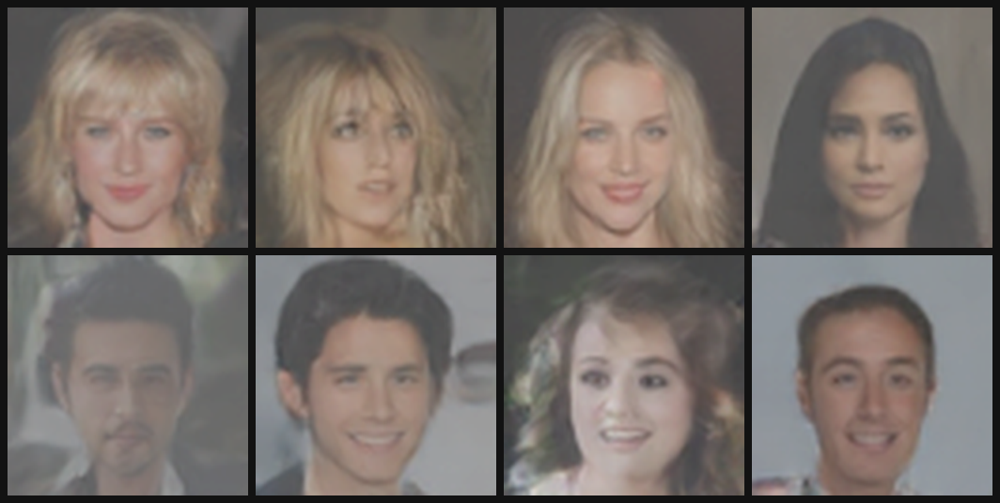
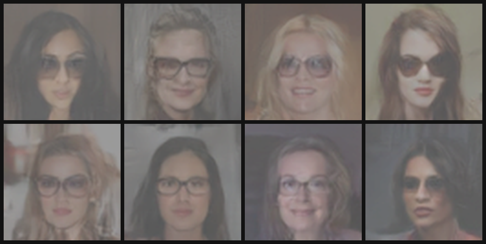

# Attribute-Guided Face Generation with a Conditional GAN

A PyTorch project that trains a conditional generative adversarial network (GAN) to synthesize 64 × 64 face images from a random latent vector and a set of requested facial attributes. The project includes training and evaluation scripts, inference-time candidate selection, saved model checkpoints, generated examples, training-progress samples, and the presentation used to explain the method.

> **Dataset note:** CelebA is not included. Download it yourself from the [official CelebA page](https://mmlab.ie.cuhk.edu.hk/projects/CelebA.html) and follow its terms. The dataset is available for non-commercial research purposes. This repository's ignore rules exclude the image directory and annotations.

## Results

Generated samples and supporting project artifacts are collected under [`results/`](results/). The folder includes generated image grids, the training-progress grids, the project presentation, and its formula assets.

### Unconditioned / natural attribute combinations



### Female with eyeglasses requested



The images are 64 × 64 model outputs enlarged for display. The generation script can apply contrast enhancement and enlargement; these display steps do not add detail that the model did not learn. Generated-face attribute scores come from the same discriminator trained with the generator, so they are useful diagnostics rather than independent quality measurements.

## What the model does

- The **generator** receives a 100-dimensional latent vector and a 10-value binary attribute vector, then upsamples them into a 64 × 64 RGB image.
- The **discriminator** shares a convolutional feature extractor and has two heads: a real/fake score and a multi-label attribute classifier.
- **Training objective:** binary cross-entropy adversarial losses encourage realistic images; multi-label binary cross-entropy losses encourage requested attribute consistency. The attribute term is weighted by `lambda_attr`.
- **Inference:** requested attributes are fixed while unspecified labels can be sampled from real CelebA label combinations. The script can try multiple latent candidates and rank them with the checkpoint's attribute head.

The selected conditioning attributes are `Male`, `Young`, `Smiling`, `Eyeglasses`, `Bald`, `Black_Hair`, `Blond_Hair`, `Brown_Hair`, `Mustache`, and `Wearing_Hat`. To request a female face, use `Female`; it maps to CelebA's `Male=0` label.

## Repository layout

```text
.
├── config.py                     # Dataset paths and model/training settings
├── data/dataset.py               # CelebA annotation reader and image transforms
├── models/                       # Generator and discriminator networks
├── utils/                         # Loss functions and sample-grid utilities
├── train.py                       # Training and checkpoint resume
├── generate.py                    # Attribute-conditioned image generation
├── evaluate.py                    # Validation and discriminator diagnostics
├── checkpoints/                   # Saved model/optimizer states (Git LFS)
├── data/celeba/                   # Empty placeholder; put the local dataset here
└── results/
    ├── generated_images/          # Final and intermediate generated examples
    ├── training_progress/         # Sample grids saved while training
    └── presentation/              # Project slides and formula source/assets
```

The virtual environment and local Python caches are intentionally excluded. Dataset files are ignored by Git and are not part of the repository.

## Requirements

- Python 3.10 or later
- PyTorch 2.0 or later
- A CUDA-capable GPU is recommended for training; CPU execution is supported but substantially slower
- Git LFS is required to retrieve the saved `.pt` checkpoints

Install Git LFS, then install the Python requirements:

```bash
git lfs install
python -m venv .venv
```

Activate the environment and install packages:

```bash
# Windows PowerShell
.venv\Scripts\Activate.ps1
python -m pip install --upgrade pip
pip install -r requirements.txt
```

```bash
# macOS / Linux
source .venv/bin/activate
python -m pip install --upgrade pip
pip install -r requirements.txt
```

## Dataset setup

Download the aligned and cropped CelebA images and the 40-attribute annotation file from the official [CelebA dataset page](https://mmlab.ie.cuhk.edu.hk/projects/CelebA.html). Extract/copy them to this layout:

```text
data/celeba/
├── img_align_celeba/
│   ├── 000001.jpg
│   └── ...
└── list_attr_celeba.txt       # Official text format, or a compatible CSV
```

The loader recognizes the official whitespace-separated `list_attr_celeba.txt` format and a CSV with an image-name column followed by the attribute columns. `config.py` points to the paths above. Dataset content remains local and is excluded by `.gitignore`.

During loading, images are center-cropped to a square, resized to 64 × 64, converted to RGB tensors, and normalized to `[-1, 1]` to match the generator's `Tanh` output. The first 98% of annotation rows are used for training and the remaining 2% for validation.

## Train

```bash
python train.py
```

Useful options:

```bash
python train.py --epochs 50 --batch_size 128 --lr 2e-4
python train.py --resume checkpoints/ckpt_epoch050.pt --epochs 200
```

`--epochs` is the final epoch count, not the number of additional epochs. A resumed run restores both model weights and optimizer states. Checkpoints are saved every five epochs by default. Training-progress grids are written to `results/training_progress/` every 500 batches.

The defaults in `config.py` are a batch size of 128, Adam learning rate `2e-4`, latent size 100, and `lambda_attr=1.0`. CUDA training enables automatic mixed precision and cuDNN benchmarking when a CUDA device is available.

## Generate images

Generate eight faces requesting a male, smiling face with eyeglasses:

```bash
python generate.py --checkpoint checkpoints/ckpt_epoch050.pt --attrs "Male,Smiling,Eyeglasses" --num_samples 8 --out results/generated_images/my_samples.png
```

Request female faces with glasses:

```bash
python generate.py --checkpoint checkpoints/ckpt_epoch050.pt --attrs "Female,Eyeglasses" --num_samples 8 --out results/generated_images/female_with_glasses.png
```

By default, unspecified attributes are sampled from matching CelebA label combinations. `--strict_attrs` instead sets every unspecified attribute to off. For each output, the script tries 64 latent samples and selects the one with the strongest requested-attribute score from the checkpoint's discriminator. Adjust this with `--candidates_per_sample`; `--top_candidates` randomly selects among the best candidates to allow more variation. `--contrast 1` disables the default display contrast adjustment, and `--scale 1` disables enlargement.

For a quick evaluation on validation faces:

```bash
python evaluate.py --checkpoint checkpoints/ckpt_epoch050.pt --max_batches 10
```

Omit `--max_batches` to evaluate the full validation split. Generated-face attribute accuracy is measured by the model's own discriminator head and should not be treated as an independent quality metric.

## Checkpoints and results

The `checkpoints/` directory contains training snapshots with generator weights, discriminator weights, both Adam optimizer states, and the epoch number. Checkpoints are stored with Git LFS because each is approximately 75 MB. Install Git LFS before cloning if you need the weights; Git LFS storage and download bandwidth are subject to GitHub's account quotas.

The tracked `results/` directory groups model outputs and the presentation separately from source code. `results/training_progress/` contains the saved training grids; `results/generated_images/` contains the curated and intermediate generation examples; `results/presentation/` contains the `.pptx` deck and the formula illustrations/source used in it.

## Current observations and limitations

- In this run, training through epoch 200 did not produce more visually varied samples than the epoch-50 model. The best checkpoint depends on the balance between requested-attribute adherence and variety; the newest checkpoint is not automatically the best.
- Attribute control is limited to the ten labels configured above and can entangle traits. The candidate-selection step is a practical filter, not a guarantee of correct attributes or image quality.
- The model generates small 64 × 64 faces from noise. It does not edit a supplied person's photograph, and the display enlargement does not increase learned detail.
- CelebA is an imbalanced celebrity-face dataset. Generated outputs can reflect its annotation and demographic biases.

## Citation and use

If you use CelebA, cite the dataset paper and follow the official [dataset terms](https://mmlab.ie.cuhk.edu.hk/projects/CelebA.html). CelebA is provided for non-commercial research purposes. This repository does not redistribute the dataset.

```text
Ziwei Liu, Ping Luo, Xiaogang Wang, and Xiaoou Tang.
Deep Learning Face Attributes in the Wild.
Proceedings of the IEEE International Conference on Computer Vision (ICCV), 2015.
```

No software license is declared for this repository yet. Ask the repository owner before reusing project code outside the rights granted by applicable law.
